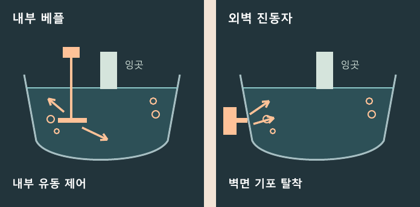

# 실리콘 잉곳의 기포 제어

국립금오공과대학교 **SSU기업주도교과목1**, SK실트론 연계 4인 팀 과제. 웨이퍼는 실리콘 단결정 덩어리인 잉곳을 얇게 잘라 만든다. 결정이 자라는 면에 기포가 머물면 내부에 빈 공간이 남을 수 있어, 결정이 굳기 전에 기포의 이동 경로를 바꿀 장치를 검토했다.

내가 제안한 방법은 실리콘 용융체 안에서 진동판(베플)을 흔드는 구조다. 최종 발표에서는 네 가지 초기 아이디어에서 좁힌 두 설계안을 비교했다.

| 설계안 | 진동을 전달하는 경로 | 기대한 작용 |
| --- | --- | --- |
| 내부 진동판 | 외부 구동부 → 축 → 용융체 내부의 판 | 판 주변의 흐름을 바꿔 성장면 가까이 머무는 기포를 이동 |
| 외벽 진동자 | 피에조 진동자 → 전달봉 → 도가니 외벽 | 벽에 붙은 기포가 떨어지도록 외부에서 진동 전달 |

## 선정 과정

- **고온 접촉부 재료.** 내부 진동판이 용융 실리콘과 직접 닿는다. 내열성과 화학 반응 가능성을 고려해 탄화규소(SiC)와 질화붕소(BN)를 후보에 넣었다.
- **중간 발표 후 수정.** 씨앗결정 자체를 흔드는 안은 결정의 성장 방향을 흐트러뜨릴 우려가 있어, 팀은 진동을 내부 유체나 도가니 벽에 전달하는 두 안으로 좁혔다.
- **최종 산출물.** 두 개념안의 구조, 작동 위치, 재료 후보와 기존 자기장 유동 제어를 병행할 가능성을 정리해 발표했다. 그림은 최종 수업 발표자료를 바탕으로 다시 그린 개념도다.
