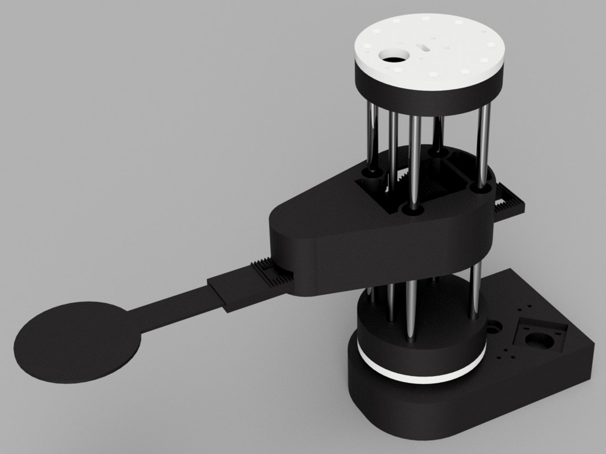

# 모형 웨이퍼 이송 로봇

국립금오공과대학교 **SSU반도체장비전산설계** 수업에서 4명이 500 × 500 mm 작업대의 네 지점 사이로 모형 웨이퍼를 옮기는 장치를 만들었다. 지름 120 mm CD를 웨이퍼로 사용했고, 가운데 구멍을 이용하지 않고 집어 올려야 했다. 최종 시제품은 처음에 100초 걸리던 경로를 약 40초에 돌았다.

나는 Fusion 360으로 기구를 모델링하고 렌더링했다. 같은 하중에서 받침 두께별 처짐을 비교하고 선정 근거를 설계 보고서에 정리했다.

## 1. 이송 구조

얇은 받침이 웨이퍼 밑으로 들어가도록 설계했다. 받침의 전후 이동은 랙과 피니언이, 높이 조절은 리드 나사가 맡는다. 시제품에서 발생한 기어 위치 이탈과 승강축 진동은 팀이 모터축의 기어를 다시 고정하고 커플러를 재조립해 해결했다.

## 2. 받침 두께 선정

0.5 N의 동일한 하중을 가정한 구조 해석 결과다. 2 mm에서 3 mm로 바꾸자 최대 처짐이 65% 줄었다. 4 mm로 두껍게 하면 0.003 mm 더 줄지만 무게가 17 g 늘어 3 mm를 선택했다.

| 두께 | 최대 처짐 | 최대 응력 | 무게 |
| --- | ---: | ---: | ---: |
| 2 mm | 0.020 mm | 3.227 MPa | 35 g |
| **3 mm** | **0.007 mm** | **1.711 MPa** | **51 g** |
| 4 mm | 0.004 mm | 1.096 MPa | 68 g |

[두께별 구조 해석 결과표 내려받기](support-analysis.csv)

## 3. 시제품 시험

급가속·감속 중 웨이퍼가 미끄러져 팀은 받침에 PDMS를 얇게 도포하고 웨이퍼가 떨어지지 않는 범위에서 모터 속도를 조정했다. 같은 네 지점을 오가는 한 사이클이 100초에서 약 40초로 줄었다.

자료는 수업 최종 보고서 「반도체장비전산설계보고서 v6」의 2.5.2절, 2.7절과 표 2.16을 바탕으로 정리했다.
